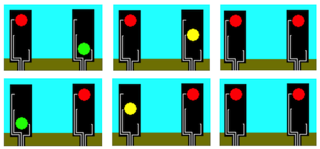
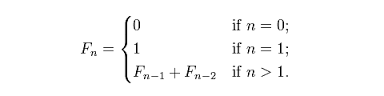
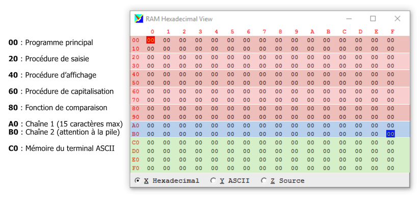

## Architecture des Ordinateurs TP n°4 (corrigé MicroSim x86)

# PROGRAMMATION ASSEMBLEUR

### 2. Commande des feux de circulation (`feux1.asm` et `feux2.asm`) :

Les configurations suivantes (de gauche à droite et de haut en bas) correspondent à la séquence `0x84`, `0x88`, `0x90`, `0x30`, `0x50`, `0x90` (et toutes les rotations possibles à partir de cette séquence), envoyées sur le **port `0x02`** :

<center></center>

**Version 1 (`feux1.asm`) :**

```asm
Rep:    mov AL, 0x84   ; AL <- 1000 0100 (rouge-vert)
        out 0x02       ; AL -> port 02
        mov AL, 0x88   ; AL <- 1000 1000 (rouge-orange)
        out 0x02       ; AL -> port 02
        mov AL, 0x90   ; AL <- 1001 0000 (rouge-rouge)
        out 0x02       ; AL -> port 02

        mov AL, 0x30   ; AL <- 0011 0000 (vert-rouge)
        out 0x02       ; AL -> port 02
        mov AL, 0x50   ; AL <- 0101 0000 (orange-rouge)
        out 0x02       ; AL -> port 02
        mov AL, 0x90   ; AL <- 1001 0000 (rouge-rouge)
        out 0x02       ; AL -> port 02

        jmp Rep        ; Recommencer
```

**Version 2 avec table de données (`feux2.asm`) :**

Même programme avec utilisation d'une table de données mémorisée à l'adresse `0x50`, terminée par la sentinelle `0xFF`.

```asm
;       ====== Programme ======

        org 0x00       ; Adresse du programme
Deb:    mov BL, 0x50   ; Initialisation de l'index
Rep:    mov AL, [BL]   ; AL <- nouvelle combinaison
        cmp AL, 0xFF   ; Fin de la séquence ?
        jz Deb         ; Si oui on recommence
        out 0x02       ; Si non AL -> port 02
        inc BL         ; Octet suivant
        jmp Rep

;       ====== Données ======

        org 0x50       ; Adresse de la table de données
        db 0x84        ; 1000 0100 (rouge-vert)
        db 0x88        ; 1000 1000 (rouge-orange)
        db 0x90        ; 1001 0000 (rouge-rouge)
        db 0x30        ; 0011 0000 (vert-rouge)
        db 0x50        ; 0101 0000 (orange-rouge)
        db 0x90        ; 1001 0000 (rouge-rouge)
        db 0xFF        ; Code de fin de séquence
```

### 3. Saisie et affichage d'une chaîne de caractères (`saisie.asm`) :

Pour détecter la pile vide lors du dépilement, on empile un code sentinelle (`0x00`) en tout début de programme. Le clavier est lu sur le **port `0x01`** et les caractères sont écrits dans le terminal ASCII à partir de `0xC0`.

```asm
;       ====== Saisie de la chaîne ======

        mov AL, 0x00   ; Code de fin de chaîne (sentinelle)
        push AL        ; Empiler la sentinelle
Rep1:   in 0x01        ; AL <- code ASCII de la touche
        push AL        ; Empiler le code ASCII
        cmp AL, 0x0D   ; Code ASCII de la touche Entrée ?
        jnz Rep1       ; Si non on recommence
        pop AL         ; Dépiler le code 0x0D (Entrée)

;       ====== Affichage de la chaîne ======

        mov BL, 0xC0   ; Adresse du terminal ASCII
Rep2:   pop AL         ; AL <- code ASCII dépilé
        cmp AL, 0x00   ; Sentinelle atteinte (pile vide) ?
        jz Fin         ; Si oui on sort de la boucle
        mov [BL], AL   ; Envoyer le caractère vers le terminal ASCII
        inc BL         ; Emplacement suivant dans le terminal
        jmp Rep2       ; On boucle
Fin:    hlt
```

### 4. Régulation de la température (`temp.asm`) :

Sur le **port `0x03`** de MicroSim :
- Le bit 1 (`0x02`) donne l'état du thermostat à 20 °C (`1` si T >= 20 °C, `0` si T < 20 °C) ;
- Le bit 7 (`0x80`) commande le brûleur (`0x80` pour allumer, `0x00` pour éteindre).

L'instruction `AND AL, 0x02` effectue un ET logique bit-à-bit entre `AL` et le masque `0x02` (`0000 0010`), ne conservant que le bit 1 et positionnant le drapeau `Z` :

```asm
Rep:    in 0x03        ; AL <- port 03
        and AL, 0x02   ; Isoler le bit 1 (seuil 20 °C)
        jz Fire        ; Si bit 1 == 0 (< 20 °C), allumer le brûleur
        mov AL, 0x00   ; Sinon éteindre le brûleur
        out 0x03       ; AL -> port 03
        jmp Rep        ; On boucle

;       ====== Allumage du brûleur ======

Fire:   mov AL, 0x80   ; AL <- 1000 0000
        out 0x03       ; Allumer le brûleur
        jmp Rep        ; On boucle
```

**Variante élégante (décalage arithmétique / logique sans saut conditionnel) :**

```asm
Rep:    in 0x03        ; AL <- port 03
        and AL, 0x02   ; Isoler le bit 1 (0x02 si >= 20 °C, 0x00 sinon)
        xor AL, 0x02   ; Inverser le bit 1 (0x02 si < 20 °C, 0x00 sinon)
        shl AL, 0x06   ; Décaler le bit 1 vers le bit 7 (0x80 ou 0x00)
        out 0x03       ; AL -> port 03
        jmp Rep
```

### 5. Calcul de la suite de Fibonacci (`fibo.asm`) :

La suite de Fibonacci est définie par récurrence :



On utilise le drapeau Carry (`C`) et l'instruction `JNC` pour détecter le dépassement de capacité 8 bits non signé (> 255) :

```asm
        mov BL, 0x00   ; BL <- 0 (Fn-2)
        mov AL, 0x01   ; AL <- 1 (Fn-1)
Rep:    push AL        ; Sauvegarder AL sur la pile
        add AL, BL     ; AL <- AL + BL (Fn-1 + Fn-2)
        pop BL         ; Restaurer l'ancien AL dans BL
        jnc Rep        ; Tant qu'il n'y a pas de retenue (C == 0), continuer
        hlt            ; Sinon c'est terminé
```

### 6. Une temporisation paramétrable (`feux3.asm`) :

Le programme reprend la table de données de `feux2.asm` en alternant chaque configuration des feux avec sa durée d'attente (`0x10` = 16 itérations après rouge-vert / vert-rouge, `0x03` = 3 itérations après les autres). La routine `Tempo` sauvegarde `SR` (`pushf`) et `AL` (`push AL`) sur la pile :

```asm
;       ====== Programme principal ======

        org 0x00       ; Adresse du programme
Deb:    mov BL, 0x50   ; Initialisation de l'index
Rep:    mov AL, [BL]   ; AL <- nouvelle combinaison
        cmp AL, 0xFF   ; Fin de la séquence ?
        jz Deb         ; Si oui on recommence
        out 0x02       ; Si non AL -> port 02
        inc BL         ; Octet suivant (durée)
        mov AL, [BL]   ; AL <- durée (paramètre de la routine)
        call Tempo     ; Appel de la routine de temporisation
        inc BL         ; Octet suivant (configuration)
        jmp Rep

;       ====== Table de données ======

        org 0x50       ; Adresse de la table de données
        db 0x84        ; 1000 0100 (rouge-vert)
        db 0x10        ; Temporisation longue (16)
        db 0x88        ; 1000 1000 (rouge-orange)
        db 0x03        ; Temporisation courte (3)
        db 0x90        ; 1001 0000 (rouge-rouge)
        db 0x03        ; Temporisation courte (3)
        db 0x30        ; 0011 0000 (vert-rouge)
        db 0x10        ; Temporisation longue (16)
        db 0x50        ; 0101 0000 (orange-rouge)
        db 0x03        ; Temporisation courte (3)
        db 0x90        ; 1001 0000 (rouge-rouge)
        db 0x03        ; Temporisation courte (3)
        db 0xFF        ; Code de fin de séquence

;       ====== Routine de temporisation ======

Tempo:  pushf          ; Sauvegarde de SR
        push AL        ; Sauvegarde de AL
Rep2:   dec AL         ; AL <- AL - 1
        jnz Rep2       ; Boucler si AL != 0
        pop AL         ; Restauration de AL
        popf           ; Restauration de SR
        ret            ; Fin de la routine
```

### 7. Quelques opérations sur les chaînes de caractères :

Organisation imposée de la mémoire RAM (emplacements des différentes parties du code) :

<center></center>

**7.1 Saisie et mémorisation d'une chaîne (`read.asm`) :**

- Paramètre 1 (`BL`) = adresse où mémoriser la chaîne

```asm
;       ====== Programme principal #1 ======

        mov BL, 0xA0   ; Adresse de la chaîne 1
        call Read      ; Saisie de la chaîne 1
        mov BL, 0xB0   ; Adresse de la chaîne 2
        call Read      ; Saisie de la chaîne 2
        hlt

;       ====== Saisie d'une chaîne ======

Read:   in 0x01        ; AL <- code ASCII
        cmp AL, 0x0D   ; Action sur ENTER ?
        jz Fin1        ; Si oui on sort de la boucle
        mov [BL], AL   ; Si non on mémorise le code
        inc BL         ; Adresse suivante
        jmp Read       ; On boucle
Fin1:   mov AL, 0x00   ; AL <- NULL
        mov [BL], AL   ; Ajouter le code de fin de chaîne
        ret
```

**7.2 Affichage d'une chaîne mémorisée (`print.asm`) :**

- Paramètre 1 (`BL`) = adresse de la chaîne à afficher
- Paramètre 2 (`CL`) = ligne du terminal ASCII (`0x00` à `0x03`)
- Paramètre 3 (`DL`) = colonne du terminal ASCII (`0x00` à `0x0F`)

```asm
;       ====== Programme principal #2 ======

        mov BL, 0xA0   ; Adresse de la chaîne
        call Read      ; Saisie de la chaîne

        mov BL, 0xA0   ; Adresse de la chaîne
        mov CL, 0x01   ; Ligne 1
        mov DL, 0x02   ; Colonne 2
        call Print     ; Affichage de la chaîne

        mov BL, 0xA0   ; Adresse de la chaîne
        mov CL, 0x02   ; Ligne 2
        mov DL, 0x06   ; Colonne 6
        call Print     ; Affichage de la chaîne
        hlt

;       ====== Saisie d'une chaîne ======

Read:   in 0x01
        cmp AL, 0x0D
        jz Fin1
        mov [BL], AL
        inc BL
        jmp Read
Fin1:   mov AL, 0x00
        mov [BL], AL
        ret

;       ====== Affichage d'une chaîne ======

Print:  mul CL, 0x10   ; Multiplier par la largeur de ligne (16)
        add CL, 0xC0   ; Ajouter l'adresse de début du terminal ASCII
        add CL, DL     ; Ajouter le numéro de colonne
Rep2:   mov AL, [BL]   ; Récupérer le code ASCII
        cmp AL, 0x00   ; Fin de la chaîne ?
        jz Fin2        ; Si oui on sort de la boucle
        mov [CL], AL   ; Si non afficher le caractère
        inc BL
        inc CL
        jmp Rep2
Fin2:   ret
```

**7.3 Mise en majuscules d'une chaîne mémorisée (`upcase.asm`) :**

- Paramètre 1 (`BL`) = adresse de la chaîne à capitaliser

```asm
;       ====== Programme principal #3 ======

        mov BL, 0xA0   ; Adresse de la chaîne
        call Read      ; Saisie de la chaîne

        mov BL, 0xA0   ; Adresse de la chaîne
        call Upcase    ; Capitalisation de la chaîne

        mov BL, 0xA0   ; Adresse de la chaîne
        mov CL, 0x02   ; Ligne 2
        mov DL, 0x06   ; Colonne 6
        call Print     ; Affichage de la chaîne
        hlt

;       ====== Saisie d'une chaîne ======

Read:   in 0x01
        cmp AL, 0x0D
        jz Fin1
        mov [BL], AL
        inc BL
        jmp Read
Fin1:   mov AL, 0x00
        mov [BL], AL
        ret

;       ====== Affichage d'une chaîne ======

Print:  mul CL, 0x10
        add CL, 0xC0
        add CL, DL
Rep2:   mov AL, [BL]
        cmp AL, 0x00
        jz Fin2
        mov [CL], AL
        inc BL
        inc CL
        jmp Rep2
Fin2:   ret

;       ====== Capitalisation d'une chaîne ======

Upcase: mov AL, [BL]   ; AL <- code ASCII
        cmp AL, 0x00   ; Fin de la chaîne ?
        jz Fin3        ; Si oui on sort de la boucle
        sub AL, 0x20   ; Si non AL <- AL - 0x20 (32 en décimal)
        mov [BL], AL   ; Remplacer le code ASCII en mémoire
        inc BL
        jmp Upcase
Fin3:   ret
```

**7.4 Comparaison de deux chaînes mémorisées (`compare.asm`) :**

- Paramètre 1 (`CL`) = adresse de la première chaîne à comparer
- Paramètre 2 (`DL`) = adresse de la deuxième chaîne à comparer
- Résultat : si les chaînes sont identiques alors `Z = 1` (`0` sinon)

```asm
;       ====== Programme principal #4 ======

        mov BL, 0xA0   ; Adresse de la chaîne 1
        call Read      ; Saisie de la chaîne 1
        mov BL, 0xB0   ; Adresse de la chaîne 2
        call Read      ; Saisie de la chaîne 2

        mov CL, 0xA0   ; Adresse de la chaîne 1
        mov DL, 0xB0   ; Adresse de la chaîne 2
        call Compare   ; Comparer les deux chaînes

        mov AL, 0x04   ; AL <- 0000 0100 (vert par défaut)
        jz Fin         ; Terminer si Z = 1
        mov AL, 0x10   ; AL <- 0001 0000 (rouge si Z = 0)
Fin:    out 0x02       ; AL -> port 02
        hlt

;       ====== Saisie d'une chaîne ======

Read:   in 0x01
        cmp AL, 0x0D
        jz Fin1
        mov [BL], AL
        inc BL
        jmp Read
Fin1:   mov AL, 0x00
        mov [BL], AL
        ret

;       ====== Comparaison de deux chaînes ======

Compare:
        mov AL, [CL]   ; AL <- Code ASCII de la chaîne 1
        mov BL, [DL]   ; BL <- Code ASCII de la chaîne 2
        cmp AL, BL     ; Comparer les deux codes ASCII
        jnz Fin4       ; Si différents alors Z = 0
        cmp AL, 0x00   ; Fin de la chaîne 1 ?
        jz Fin4        ; Si oui alors chaînes égales et Z = 1
        inc CL
        inc DL
        jmp Compare
Fin4:   ret
```

<center></center>
