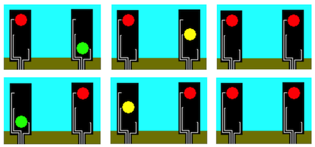
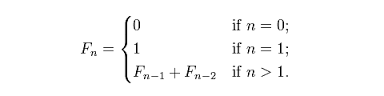
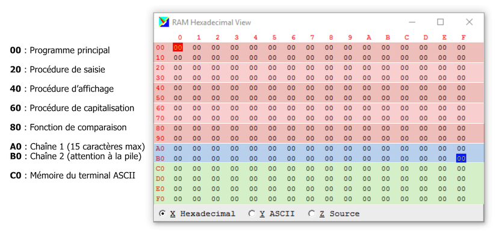

## Architecture des Ordinateurs TP n°4 (corrigé)

# PROGRAMMATION ASSEMBLEUR

### 2. Commande des feux de circulation :

Les configurations suivante (de gauche à droite et de haut en bas) correspondent à la séquence 0x84, 0x88, 0x90, 0x30, 0x50, 0x90 (et toutes les rotations possible à partir de cette séquence) :

<center></center>

```
Rep:    MOV AL,84   ; AL <— 1000 0100 (rouge-vert)
        OUT 01      ; AL —> port 01
        MOV AL,88   ; AL <- 1000 1000 (rouge-orange)
        OUT 01      ; AL —> port 01
        MOV AL,90   ; AL <— 1001 0000 (rouge-rouge)
        OUT 01      ; AL —> port 01
       
        MOV AL,30   ; AL <— 0011 0000 (vert-rouge)
        OUT 01      ; AL —> port 01
        MOV AL,50   ; AL <— 0101 0000 (orange-rouge)
        OUT 01      ; AL —> port 01
        MOV AL,90   ; AL <— 1001 0000 (rouge-rouge)
        OUT 01      ; AL —> port 01
       
        JMP Rep     ; Recommencer
        END
```

Même programme mais avec utilisation d'une table de données mémorisée à l'adresse 0x50. Pour identifier la fin de la séquence, on ajoute à la fin un code 0xFF :

```
;       ====== Données ======

        ORG 50      ; Adresse de la table de données
        DB 84       ; 1000 0100 (rouge-vert)
        DB 88       ; 1000 1000 (rouge-orange)
        DB 90       ; 1001 0000 (rouge-rouge)
        DB 30       ; 0011 0000 (vert-rouge)
        DB 50       ; 0101 0000 (orange-rouge)
        DB 90       ; 1001 0000 (rouge-rouge)
        DB FF       ; Code de fin de séquence

;       ====== Programme ======

        ORG 00      ; Adresse du programme
Deb:    MOV BL,50   ; Initialisation de l'index
Rep:    MOV AL,[BL] ; AL <— nouvelle combinaison
        CMP AL,FF   ; Fin de la séquence ?
        JZ Deb      ; Si oui on recommence
        OUT 01      ; Si non AL —> port 01
        INC BL      ; Octet suivant
        JMP Rep
        END
```

### 3. Saisie et affichage d'une chaîne de caractères :

Pour compter le nombre de caractères saisis au clavier, une solution serait d'utiliser un compteur (registre CL par exemple) mais dans la correction suivante, nous avons fait le choix d'utiliser plutôt un "code de fin de chaîne" (octet 0x00) qui est empilé en tout début de programme :

```
;       ====== Saisie de la chaîne ======

        MOV AL,00   ; Code de fin de chaîne (arbitraire)
        PUSH AL     ; Empiler le code de fin de chaîne
Rep1:   IN 00       ; AL <— code ASCII de la touche
        PUSH AL     ; On empile le code ASCII
        CMP AL,0D   ; Code ASCII de la touche Entrée ?
        JNZ Rep1    ; Si non on recommence
        POP AL      ; Dépiler le dernier code ASCII

;       ====== Affichage de la chaîne ======

        MOV BL,C0   ; Adresse du terminal ASCII
Rep2:   POP AL      ; AL <— code ASCII dépilé
        CMP AL,00   ; Code de fin de chaîne ?
        JZ Fin      ; Si oui on sort de la boucle
        MOV [BL],AL	; Envoyer le caractère vers le terminal ASCII
        INC BL      ; Emplacement suivant dans le terminal
        JMP Rep2    ; On boucle
Fin:    END
```

### 4. Régulation de la température :

Le LSB (bit 0) donne l'état du thermostat, tandis que le MSB (bit 7) permet de commander le brûleur :

- Vérifier le thermostat : extraire et tester le bit 0 de l'octet en provenance du port 03 ;
- Allumer le brûleur : envoyer l'octet 0x00 (0000 0000) vers le port 03 ;
- Eteindre le brûleur : envoyer l'octet 0x80 (1000 0000) vers le port 03 ;

L'instruction `AND AL,01` effectue un AND logique (bit-à-bit) entre l'octet contenu dans le registre AL et l'octet 0x01 (0000 0001) qui constitue alors un masque. La conséquence de cette opération est de ne conserver que la valeur du bit 0 de AL (les autres sont positionnés à zéro) :

- Soit ce bit est égal à 0, alors l'octet contenu dans AL devient 0000 0000 ;
- Soit ce bit est égal à 1, alors l'octet contenu dans AL devient 0000 0001 ;

Comme l'instruction AND positionne les flags du status register, on peut utiliser une instruction de saut conditionnel pour contrôler le programme :

```
Rep:    IN 03       ; AL <— port 03
        AND AL,01   ; Masquer les 7 bits de poids fort
        JZ Fire     ; Si le résultat est égal à 0 allumer le bruleur
        MOV AL,00   ; Sinon éteindre le bruleur
        OUT 03      ; AL —> port 03
        JMP Rep     ; On boucle

;       ====== Allumage du bruleur ======

Fire:   MOV AL,80   ; AL <— 1000 0000
        OUT 03      ; Allumer le bruleur
        JMP Rep     ; On boucle
        END
```

**Belles solutions d'étudiants :**

```
Rep:    IN 03       ; AL <— port 03
        XOR AL,01   ; Masque pour inverser la valeur du termostat
        ADD AL,7F	; Transforme le LSB en MSB
        OUT 03		; AL —> port 03
        JMP Rep		; On boucle
```

```
Rep:    IN 03       ; AL <— port 03
        NOT AL      ; Inverse la valeur
        AND AL, 01	; Regarde si le LSB est 1
        MUL AL,80	; Multiplie par 80 
        OUT 03
        JMP Rep
```

### 5. Calcul de la suite de Fibonacci :

La suite de Fibonacci se définie par récurrence de la façon suivante :



```
        MOV BL,00   ; BL <— 0 (= Fn-2)
        MOV AL,01   ; AL <— 1 (= Fn-1)
Rep:    PUSH AL     ; Sauvegarder la valeur de AL sur la pile
        ADD AL,BL   ; AL <— AL + BL (= Fn-1 + Fn-2)
        POP BL      ; Restaurer l'ancienne valeur de AL dans BL
        JNO Rep     ; Si pas d'overflow on continue
        END         ; Sinon c'est terminé
```

### 6. Une temporisation paramétrable :

Le programme suivant est une modification de l'exercice #2 du précédent TP (feux de circulation). La modification consiste en l'appel d'une routine de temporisation après chaque modification de configuration des feux. Le paramètre de la temporisation est un nombre d'itérations (passée par le registre AL) à effectuer :

- Après les configurations (rouge-vert) et (vert-rouge) = 16 itérations
- Après les configurations (rouge-rouge), (rouge-orange) et (orange-rouge) = 3 itérations

Il n'est impératif de sauvegarder sur la pile les registres AL et SR (status register) modifiés par la routine car leurs modifications n'impacte pas le déroulement du programme principal. Ceci dit, pour l'exemple, ces sauvegardes et restaurations sont réalisées :

```
;       ====== Table de données ======

        ORG 50      ; Adresse de la table de données
        DB 84       ; 1000 0100 (rouge-vert)
        DB 0F       ; Temporisation longue
        DB 88       ; 1000 1000 (rouge-orange)
        DB 03       ; Temporisation courte
        DB 90       ; 1001 0000 (rouge-rouge)
        DB 03       ; Temporisation courte
        DB 30       ; 0011 0000 (vert-rouge)
        DB 0F       ; Temporisation longue
        DB 50       ; 0101 0000 (orange-rouge)
        DB 03       ; Temporisation courte
        DB 90       ; 1001 0000 (rouge-rouge)
        DB 03       ; Temporisation courte
        DB FF       ; Code de fin de séquence

;       ====== Programme principal ======

        ORG 00      ; Adresse du programme
Deb:    MOV BL,50   ; Initialisation de l'index
Rep:    MOV AL,[BL] ; AL <— nouvelle combinaison
        CMP AL,FF   ; Fin de la séquence ?
        JZ Deb      ; Si oui on recommence
        OUT 01      ; Si non AL —> port 01
        INC BL      ; Octet suivant (durée)
        MOV AL,[BL] ; AL <— durée (paramètre de la routine)
        CALL 60     ; Appel de la routine de temporisation
        INC BL      ; Octet suivant (configuration)
        JMP Rep

;       ====== Routine de temporisation ======

        ORG 60      ; Adresse de la routine
        PUSHF       ; Sauvegarde de SR
        PUSH AL     ; Sauvegarde de AL
Rep2:   NOP         ; Ne rien faire
        DEC AL      ; AL <— AL – 1
        JNZ Rep2    ; Boucler si AL != 0
        POP AL      ; Restauration de AL
        POPF        ; Restauration de SR
        RET         ; Fin de la routine
        
        END         ; Fin du programme
```

### 7. Quelques opérations sur les chaînes de caractères :

Organisation imposée de la mémoire RAM (emplacements des différentes parties du code) :

<center></center>

**7.1 Saisie et mémorisation d'une chaîne :**

- Paramètre 1 (registre BL) = adresse où mémoriser la chaîne

```
;       ====== Saisie d'une chaîne ======

        ORG 20
Rep1:   IN 00       ; AL <— code ASCII
        CMP AL,0D   ; Action sur ENTER ?
        JZ Fin1     ; Si oui on sort de la boucle
        MOV [BL],AL ; Si non on mémorise le code
        INC BL      ; Adresse suivante
        JMP Rep1    ; On boucle
Fin1:   MOV AL,00   ; AL <— NULL
        MOV [BL],AL ; Ajouter le code de fin de chaîne
        RET

;       ====== Programme principal #1 ======

        ORG 00
        MOV BL,A0   ; Adresse de la chaîne 1
        CALL 20		; Saisie de la chaîne
        MOV BL,B0   ; Adresse de la chaîne 2
        CALL 20		; Saisie de la chaîne
        END
```

**7.2 Affichage d'une chaîne mémorisée :**

- Paramètre 1 (registre BL) = adresse de la chaîne à afficher
- Paramètre 2 (registre CL) = ligne du terminal ASCII (de 00 à 03)
- Paramètre 3 (registre DL) = colonne du terminal ASCII (de 00 à 0F)

```
;       ====== Affichage d'une chaîne ======

        ORG 40
        MUL CL,10   ; Multiplier par le nombre de lignes
        ADD CL,C0   ; Ajouter l'adresse de début de l'écran
        ADD CL,DL	; Ajouter le nombre de colonne
Rep2:   MOV AL,[BL] ; Récupérer le code ASCII
        CMP AL,00   ; Fin de la chaîne ?
        JZ Fin2     ; Si oui on sort de la boucle
        MOV [CL],AL ; Si non afficher le caractère
        INC BL
        INC CL
        JMP Rep2
Fin2:   RET

;       ====== Programme principal #2 ======

        ORG 00
        MOV BL,A0   ; Adresse de la chaîne
        CALL 20		; Saisie de la chaîne
        
        MOV BL,A0	; Adresse de la chaîne
        MOV CL,1    ; Ligne 1
        MOV DL,2    ; Colonne 3
        CALL 40		; Affichage de la chaîne
        
        MOV BL,A0	; Adresse de la chaîne
        MOV CL,2    ; Ligne 2
        MOV DL,6    ; Colonne 6
        CALL 40		; Affichage de la chaîne
        END
```

**7.3 Mise en majuscules d'une chaîne mémorisée :**

- Paramètre 1 (registre BL) = adresse de la chaîne à capitaliser

```
;       ====== Capitalisation d'une chaîne ======

        ORG 60
Rep3:   MOV AL,[BL] ; AL <— code ASCII
        CMP AL,00   ; Fin de la chaîne ?
        JZ Fin3		; Si oui on sort de la boucle
        SUB AL,20   ; Si non AL <— AL – 0x20 (32 en base 10)
        MOV [BL],AL ; On remplace le code ASCII
        INC BL
        JMP Rep3
Fin3:   RET

;       ====== Programme principal #3 ======

        ORG 00
        MOV BL,A0   ; Adresse de la chaîne
        CALL 20		; Saisie de la chaîne
        
        MOV BL,A0	; Adresse de la chaîne
        CALL 60		; Capitalisation de la chaîne
        
        MOV BL,A0	; Adresse de la chaîne
        MOV CL,2    ; Ligne 2
        MOV DL,6    ; Colonne 6
        CALL 40		; Affichage de la chaîne
        END
```

**7.4 Comparaison de deux chaînes mémorisées :**

- Paramètre 1 (registre CL) = adresse de la première chaîne à comparer
- Paramètre 2 (registre DL) = adresse de la deuxième chaîne à comparer
- Résultat : si les chaînes sont identiques alors flag Z = 1 (0 sinon)

```
;       ====== Comparaison de deux chaînes ======

        ORG 80
Rep4:   MOV AL,[CL] ; AL <— Code ASCII de la chaîne 1
        MOV BL,[DL] ; BL <— Code ASCII de la chaîne 2
        CMP AL,BL   ; Comparer les deux codes ASCII
        JNZ Fin4    ; Si différents alors chaînes différentes et Z = 0
        CMP AL,00   ; Fin de la chaîne 1 ?
        JZ Fin4		; Si oui alors chaîne égales et Z = 1
        INC CL
        INC DL
        JMP Rep4
Fin4:   RET

;       ====== Programme principal #4 ======

        ORG 00
        MOV BL,A0   ; Adresse de la chaîne 1
        CALL 20		; Saisie de la chaîne
        MOV BL,B0   ; Adresse de la chaîne 2
        CALL 20		; Saisie de la chaîne

        MOV CL,A0   ; Adresse de la chaîne 1
        MOV DL,B0   ; Adresse de la chaîne 2
        CALL 80     ; Comparer les deux chaîne
        
        MOV AL,04   ; AL <— 0000 0100 (vert par défaut)
        JZ Fin      ; Terminer si Z = 1
        MOV AL,10   ; AL <— 0001 0000 (rouge si Z = 0)
Fin:    OUT 01      ; AL —> port 01
        END
```

<center></center>

[sms32]: http://www.softwareforeducation.com/sms32v50/
[masm]: https://fr.wikipedia.org/wiki/Microsoft_Macro_Assembler

