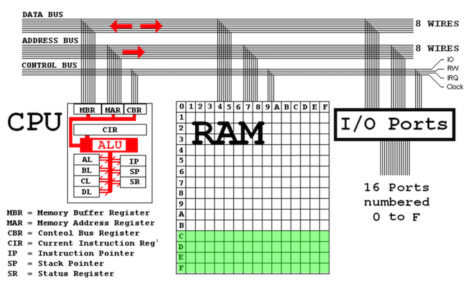
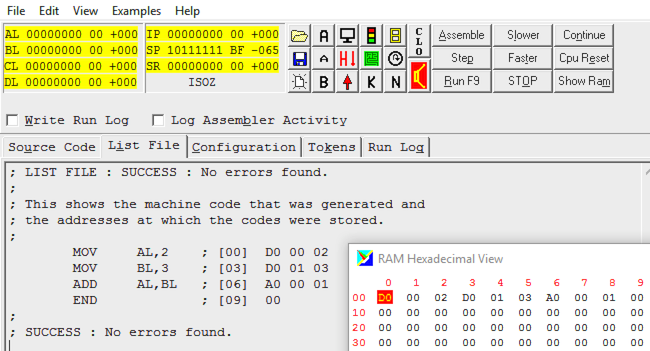
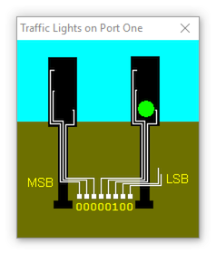
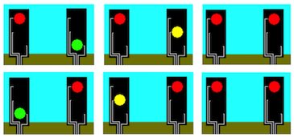
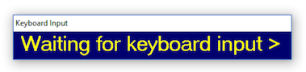
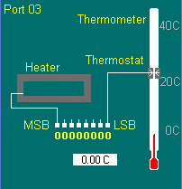
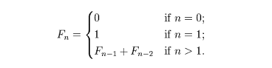
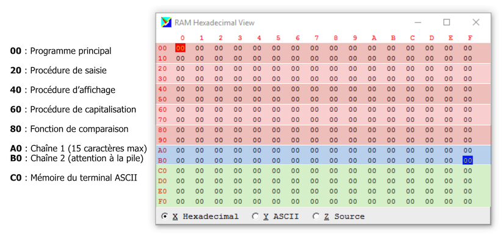
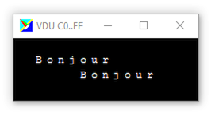
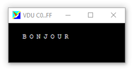

## Architecture des Ordinateurs TP n°4

# PROGRAMMATION ASSEMBLEUR (MicroSim x86)

### Objectifs du TP 

Le but de ce TP est d'explorer la programmation au plus bas niveau (au plus proche de la machine). Programmer en « langage machine » (assembleur) permet de bien comprendre les mécanismes liés à l'exécution d'un programme : mémorisation de données, réalisation d'opérations, appel de fonctions, etc., qui sont plus ou moins cachés dans les langages de plus haut niveau.

### Travail à rendre à la fin du TP :

Vous déposerez directement dans UMTICE les programmes en langage machine (extension `.asm`) suivants :

- Feux de circulation version 1 : `feux1.asm`
- Feux de circulation version 2 : `feux2.asm`
- Saisie et affichage d'une chaîne : `saisie.asm`
- Régulation de la température : `temp.asm`
- Suite de Fibonacci : `fibo.asm`
- Feux de circulation version 3 : `feux3.asm`
- Fonction saisie d'une chaîne : `read.asm`
- Fonction affichage d'une chaîne : `print.asm`
- Mise en majuscules d'une chaîne : `upcase.asm`
- Comparaison de deux chaînes : `compare.asm`

<font color=red>Ce TP est à réaliser individuellement. Toute preuve de plagiat ou de copié-collé entre productions impactera significativement la note finale de TP du module.</font>

### Le simulateur MicroSim x86 :

Dans un souci de simplification, vous ne programmerez pas un vrai microprocesseur, mais un microprocesseur simulé 8 bits de type Intel 80x86, possédant un jeu d'instructions simplifié. Les caractéristiques du simulateur [MicroSim](https://github.com/jlehuen/microsim_8bits) sont les suivantes :

- Architecture Von Neumann 8 bits (adresses et données sur 8 bits) ;
- 4 registres 8 bits à usage général (`AL`, `BL`, `CL`, `DL`) et pointeur de pile `SP` (initialisé à `0xBF`) ;
- Registre d'état `SR` contenant les drapeaux `S`, `Z`, `O`, `C`, `F` ;
- Mémoire adressable de 256 octets (de `0x00` à `0xFF`) ;
- Zone-mémoire du terminal ASCII de `0xC0` à `0xFF` (4 lignes de 16 caractères) ;
- Périphériques virtuels accessibles par ports d'E/S :
  - **Port `0x01`** : Clavier (`IN 0x01`)
  - **Port `0x02`** : Feux tricolores (`OUT 0x02`)
  - **Port `0x03`** : Système de chauffage / thermostat (`IN 0x03` / `OUT 0x03`)
- Assembleur intégré de type [MASM](https://en.wikipedia.org/wiki/Microsoft_Macro_Assembler) simplifié :
  - Les nombres **sans préfixe** sont interprétés en **décimal** (`10`, `16`) ;
  - Les nombres **hexadécimaux** doivent être préfixés par **`0x`** (`0x0A`, `0x50`, `0xFF`) ;
  - La fin d'exécution d'un programme est indiquée par l'instruction **`HLT`**.

<center></center>

L'interface permet d'éditer du code, de l'assembler (**Assemble**) et de l'exécuter en mode continu (**Start/Stop**) ou pas-à-pas (**Step-by-step**) tout en visualisant l'évolution des registres ainsi que le contenu de la mémoire RAM.

--
### 1. Prise en main du simulateur :

L'objectif est de prendre en main le simulateur, d'utiliser les registres et les instructions arithmétiques. Soit le programme suivant :

```asm
        mov AL, 0x02   ; AL <- 2
        mov BL, 0x03   ; BL <- 3
        add AL, BL     ; AL <- AL + BL
        hlt            ; Stopper le processeur
```

1. Lancez le simulateur MicroSim ;
2. Affichez le contenu de la mémoire (**Show/hide RAM**) en mode Hexadécimal ;
3. Copiez-collez le code ci-dessus ;
4. Sauvegardez-le (**Save program as**) dans votre espace personnel ;
5. Assemblez-le (**Assemble**) ;
6. Retrouvez le code hexadécimal chargé en mémoire RAM à l'adresse `0x00` ;
7. Exécutez le programme (**Start/Stop**) ;
8. Réinitialisez le système (**Reset**), puis exécutez-le en mode pas-à-pas (**Step-by-step**) en suivant l'évolution des registres ;
9. Modifiez le programme afin de réaliser une soustraction (`SUB`), une multiplication (`MUL`) et une division (`DIV`) ;
10. Que se passe-t-il en cas de division par zéro ? (Observez le drapeau `F` dans `SR`.)

<center></center>

<font color=red>
*Ne déposez pas cet exercice dans la zone de dépôt*
</font>

--
### 2. Commande des feux de circulation :

La finalité est d'utiliser l'instruction de saut inconditionnel, une table de données, ainsi qu'un port de sortie. Dans MicroSim, envoyer un octet vers le **port `0x02`** (via le registre `AL`) permet de commander les 6 lampes des feux de circulation (deux bits sont inutilisés) :

<center></center>

- Commencez par copier-coller et exécuter le code suivant (pensez à ouvrir la fenêtre des feux tricolores via **Show/hide traffic lights**) :

```asm
Rep:    mov AL, 0x00   ; AL <- 0000 0000
        out 0x02       ; Éteindre tous les feux
        mov AL, 0xFC   ; AL <- 1111 1100
        out 0x02       ; Allumer tous les feux
        jmp Rep        ; Recommencer
```

- Modifiez-le afin de contrôler les feux de circulation selon le cycle en vigueur en France :

<center></center>

<font color=red>
*Déposez cet exercice sous le nom : feux1.asm*
</font>

- Écrivez un nouveau programme sur la base du précédent, en utilisant une **table de données** (directive d'assemblage `DB`) contenant les valeurs successives à transmettre au périphérique. Cette table sera mémorisée à l'adresse `0x50` (`ORG 0x50`). La fin de la séquence sera identifiée par l'octet `0xFF`. La séquence devra tourner en boucle infinie. Inspirez-vous du programme « Hello World » du manuel, qui utilise une table de données ASCII.

```asm
        org 0x50       ; Adresse de la séquence
        db 0x84        ; 1000 0100 (rouge-vert)
        db <octet>
        db <octet>
        ...
        db 0xFF        ; Fin de la séquence
```

<font color=red>
*Déposez cet exercice sous le nom : feux2.asm*
</font>

--
### 3. Saisie et affichage d'une chaîne de caractères :

L'objectif est d'utiliser un périphérique d'entrée, un périphérique de sortie, ainsi que la pile. Les entrées se feront par l'intermédiaire du clavier de l'ordinateur, et les sorties par l'intermédiaire du petit terminal ASCII. Dans MicroSim, lire un octet en provenance du **port `0x01`** (via `IN 0x01`) permet d'attendre une touche du clavier et d'en placer le code ASCII dans `AL` :

<center></center>

Commencez par copier-coller et exécuter le code suivant (ouvrez les fenêtres **Keyboard** et **ASCII Display**), puis modifiez-le afin de :

- Mémoriser dans la pile les caractères saisis au clavier ;
- Afficher les caractères dans l'ordre inverse de la saisie dans le terminal ASCII (`0xC0` à `0xFF`) ;

```asm
Rep:    in 0x01        ; Attente et mémorisation dans AL
        cmp AL, 0x0D   ; Code ASCII de la touche Entrée ?
        jnz Rep        ; Si non on recommence
        hlt            ; Si oui fin du programme
```

La principale difficulté est ici de gérer correctement la pile car :

- Le code de la touche `Enter` (`0x0D`) ne doit pas être envoyé à l'écran ;
- La boucle d'affichage doit s'arrêter lorsque la pile est vide (sans provoquer d'erreur *Stack Underflow* sur le drapeau `F`).

<font color=red>
*Déposez cet exercice sous le nom : saisie.asm*
</font>

--
### 4. Régulation de la température :

L'objectif est d'exploiter le périphérique chaudière / thermostat, ainsi que d'extraire la valeur d'un bit dans un octet. Dans cet exercice, les octets en entrée et en sortie transitent par le **port `0x03`** :

- Commander la chaudière = écrire un octet sur le port `0x03` (`OUT 0x03`) : le bit 7 (MSB) allume (`0x80`) ou éteint (`0x00`) le brûleur ;
- Tester le thermostat = lire un octet sur le port `0x03` (`IN 0x03`) :
  - le **bit 0 (`0x01`)** vaut `1` si la température est supérieure ou égale à 10 °C (`0` sinon) ;
  - le **bit 1 (`0x02`)** vaut `1` si la température est supérieure ou égale à 20 °C (`0` sinon) ;
  - le **bit 7 (`0x80`)** reflète l'état actuel du brûleur.

<center></center>

Écrivez un programme qui démarre le brûleur si la température est inférieure à **20 °C** et qui l'arrête sinon. Vous utiliserez un opérateur logique pour extraire la valeur du bit correspondant dans l'octet lu (méthode du masque).

<font color=red>
*Déposez cet exercice sous le nom : temp.asm*
</font>

--
### 5. Calcul des termes de la suite de Fibonacci :

L'objectif est d'associer plusieurs moyens de stockage (registres et pile) et de gérer un dépassement de capacité. La suite de Fibonacci est définie par récurrence de la façon suivante :



Calculez dans le registre `AL` les termes successifs de la suite de Fibonacci (en entiers non signés sur 8 bits) jusqu'au dépassement de capacité (**flag Carry `C`**, testé avec `JNC`). La pile vous permettra de mémoriser temporairement la dernière valeur de la suite.

<font color=red>
*Déposez cet exercice sous le nom : fibo.asm*
</font>

--
### 6. Une temporisation paramétrable :

L'objectif est d'écrire une routine de temporisation que vous allez insérer dans le code des feux tricolores de l'exercice 2. Dans cet exercice, la durée de la temporisation (en nombre de répétitions) sera passée à la routine par l'intermédiaire du registre `AL` :

- Après les configurations (rouge-vert) et (vert-rouge) = `16` itérations (`0x10`) ;
- Après les configurations (rouge-rouge), (rouge-orange) et (orange-rouge) = `3` itérations (`0x03`) ;
- Les registres modifiés par la routine de temporisation devront être sauvegardés via la pile ;

Commencez par copier-coller et exécuter le code suivant :

```asm
; Programme principal

        call Tempo     ; Appel de la routine
        call Tempo     ; Appel de la routine
        hlt            ; Stopper le processeur

; Routine de temporisation

Tempo:  mov AL, 0x03   ; AL <- 3
Rep:    dec AL         ; AL <- AL - 1
        jnz Rep        ; Recommencer si AL != 0
        ret            ; Fin de la routine
```

Pendant l'exécution, suivez en particulier les registres `IP` (instruction pointer) et `SP` (stack pointer), ainsi que le contenu de la mémoire RAM en mode hexadécimal, de façon à bien comprendre le fonctionnement des instructions `CALL` et `RET`.

Ensuite, intégrez la routine de temporisation au code des feux tricolores (version avec table de données) et modifiez le programme (code principal et routine) de façon à :

- Mémoriser les durées dans la table de données, en alternance avec les configurations ;
- Appeler la routine de temporisation après chaque changement de configuration ;

Exécutez votre programme à vitesse maximum (curseur de vitesse au maximum) pour tester les temporisations. Les configurations avec feux verts devront durer plus longtemps que les autres configurations, pour laisser le temps aux voitures de passer.

<font color=red>
*Déposez cet exercice sous le nom : feux3.asm*
</font>

--
### 7. Quelques opérations sur les chaînes de caractères :

L'objectif est d'écrire en assembleur quelques routines et fonctions sur les chaînes de caractères :

1. Une routine de saisie d'une chaîne de caractères ;
2. Une routine d'affichage d'une chaîne de caractères ;
3. Une routine de mise en majuscules d'une chaîne de caractères ;
4. Une fonction de comparaison entre deux chaînes de caractères.

Étant donnée la petite taille de la RAM du simulateur (256 octets), l'organisation de la mémoire doit être optimisée. Vous coderez quatre versions du programme principal : une pour tester la saisie, une pour tester l'affichage, une pour tester la capitalisation, et une pour tester la comparaison. Pour économiser de précieux octets, les routines ne sauvegarderont pas les registres modifiés et seront placées les unes à la suite des autres à l'aide de **labels** (sans directive `org` intermédiaire) : le code reste ainsi compacté à partir de `0x00` et laisse un maximum d'espace libre avant la zone réservée aux chaînes (`0xA0` et `0xB0`). Vous veillerez simplement dans l'inspecteur RAM à ce que votre programme ne dépasse pas l'adresse `0x9F`.

<center></center>

**7.1 Saisie et mémorisation d'une chaîne :**

- Paramètre 1 (registre `BL`) = adresse où mémoriser la chaîne

Cette première routine (étiquetée `Read:`) utilise le clavier sur le port `0x01`. La chaîne sera mémorisée en RAM à l'adresse passée en paramètre. La fin de la saisie sera indiquée par la touche `Enter` (`0x0D`), mais les chaînes seront terminées en mémoire par le code ASCII `0x00` (`NULL`).

Le programme principal devra saisir et mémoriser deux chaînes : l'une en `0xA0` et l'autre en `0xB0`. Vous prendrez garde à un éventuel conflit (non détectable à l'assemblage) entre la chaîne 2 en `0xB0` et la pile dont la base est située en `0xBF`.

<center></center>

<font color=red>
*Déposez cet exercice sous le nom : read.asm*
</font>

**7.2 Affichage d'une chaîne mémorisée :**

- Paramètre 1 (registre `BL`) = adresse de la chaîne à afficher
- Paramètre 2 (registre `CL`) = ligne du terminal ASCII (de `0x00` à `0x03`)
- Paramètre 3 (registre `DL`) = colonne du terminal ASCII (de `0x00` à `0x0F`)

Cette deuxième routine (étiquetée `Print:`) doit afficher une chaîne mémorisée en RAM sur le terminal ASCII (`0xC0` à `0xFF`) à la position donnée. Les chaînes sont terminées par `0x00` (`NULL`).

Le programme principal devra saisir, mémoriser et afficher une chaîne. Vous réaliserez deux affichages de la même chaîne à deux positions différentes :

<center></center>

<font color=red>
*Déposez cet exercice sous le nom : print.asm*
</font>

**7.3 Mise en majuscules d'une chaîne mémorisée :**

- Paramètre 1 (registre `BL`) = adresse de la chaîne à capitaliser

Cette troisième routine (étiquetée `Upcase:`) doit capitaliser (mettre en majuscules) une chaîne mémorisée en RAM directement en modifiant ses codes ASCII en mémoire. Dans un premier temps, et pour simplifier, les chaînes seront saisies en minuscules.

Le programme principal devra saisir une chaîne, la mettre en majuscules, et l'afficher à une position donnée :

<center></center>

<font color=red>
*Déposez cet exercice sous le nom : upcase.asm*
</font>

**7.4 Comparaison de deux chaînes mémorisées :**

- Paramètre 1 (registre `CL`) = adresse de la première chaîne à comparer
- Paramètre 2 (registre `DL`) = adresse de la deuxième chaîne à comparer

Le rôle de la fonction de comparaison de chaînes (étiquetée `Compare:`) est de permettre un saut conditionnel selon que les deux chaînes sont égales ou non. Elle doit positionner le drapeau `Z` du registre d'état `SR` :

- Si les deux chaînes sont différentes alors `Z = 0` ;
- Si les deux chaînes sont égales alors `Z = 1`.

Le drapeau `Z` est positionné suite à l'utilisation de l'instruction de comparaison (`CMP`) entre deux octets contenus dans deux registres. L'algorithme repose donc sur une série de comparaisons, caractère par caractère.

Dans un premier temps, le programme principal devra saisir deux chaînes et les comparer (le résultat doit être visible au niveau du drapeau `Z`).

Dans un deuxième temps, vous utiliserez le drapeau `Z` pour commander les feux tricolores (port `0x02`) :

- Si les deux chaînes sont différentes alors le feu rouge est allumé (`0x10`) ;
- Si les deux chaînes sont égales alors le feu vert est allumé (`0x04`).

<font color=red>
*Déposez cet exercice sous le nom : compare.asm*
</font>

<center></center>

<center></center>
