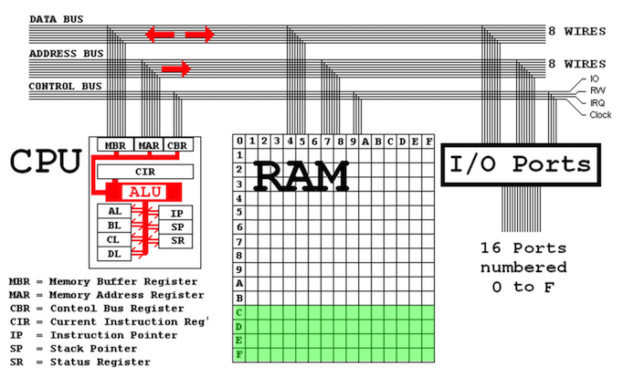
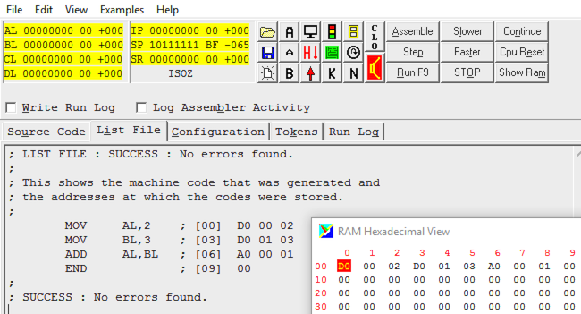
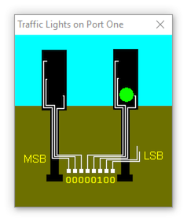
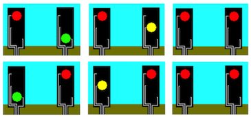
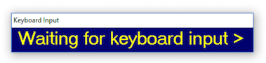
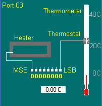
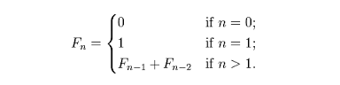
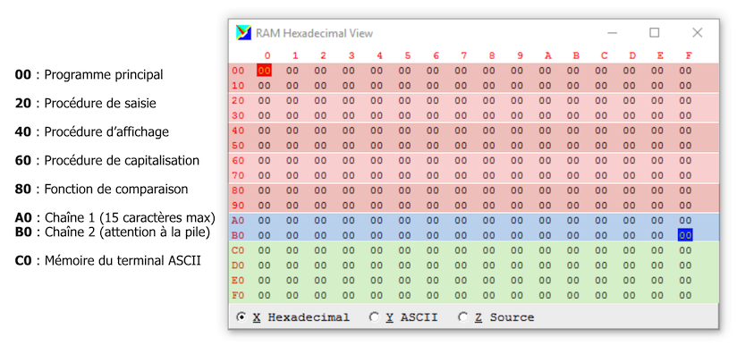
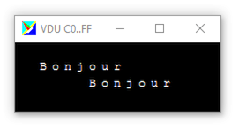
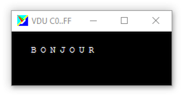

## Architecture des Ordinateurs TP n°4

# PROGRAMMATION ASSEMBLEUR

### Objectifs du TP 

Le but de ce TP est d'explorer la programmation au plus bas niveau (au plus proche de la machine). Programmer en "langage machine" (assembleur) permet de bien comprendre les mécanismes liés à l'exécution d'un programme : mémorisation de données, réalisation d'opérations, appel de fonctions, etc. qui sont plus ou moins "cachés" dans les langages de plus haut niveau.

### Travail à rendre à la fin du TP :

Vous déposerez directement dans UMTICE les programmes en langage machine (extension .asm) suivants :

- Feux de circutation version 1 : `feux1.asm`
- Feux de circulation version 2 : `feux2.asm`
- Saisie et affichage d'une chaîne : `saisie.asm`
- Régulation de la température : `temp.asm`
- Suite de fibonacci : `fibo.asm`
- Feux de circutation version 3 : `feux3.asm`
- Fonction saisie d'une chaîne : `read.asm`
- Fonction affichage d'une chaîne : `print.asm`
- Mise en majuscules d'une chaîne : `upcase.asm`
- Comparaison de deux chaînes : `compare.asm`

<font color=red>Ce TP est à réaliser individuellement. Toute preuve de plagiat ou de copié-collé entre productions impactera significativement la note finale de TP du module.</font>

### Le simulateur MicroSim x86 :

Dans un souci de simplification, vous ne programmerez pas un vrai microprocesseur, mais un microprocesseur simulé de type Intel 80x86, possédant un jeu d'instructions également simplifié. Les caractéristiques du simulateur [MicroSim](https://github.com/jlehuen/MicroSim) sont les suivantes :

- Architecture Von Neumann 8 bits (adresses et données) ;
- 4 registres 8 bits à usage général (de AL à DL) ;
- Mémoire adressable de 256 octets (de 0x00 à 0xFF) ;
- Zone-mémoire du terminal ASCII de 0xC0 à 0xFF ;
- 16 ports d'entrée-sorties (de 0x0 à 0xF) ;
- 9 périphériques virtuels (entrées et sorties) ;
- Mécanismes d'interruption (matériels et logiciels) ;
- Assembleur intégré de type [MASM](https://en.wikipedia.org/wiki/Microsoft_Macro_Assembler) simplifié.

<center></center>

L'interface permet d'éditer du code, de l'assembler et de l'exécuter (en mode pas-à-pas ou en continu) tout en visualisant l'évolution des registres, ainsi que le contenu de la mémoire.

--
### 1. Prise en main du simulateur :

L'objectif est de prendre en main le simulateur, d'utiliser les registres et les instructions arithmétiques. Soit le programme suivant :

```
       mov AL,0x02    ; AL <— 2
       mov BL,0x03    ; BL <— 3
       add AL,BL      ; AL <— AL + BL
```

1. Lancez le simulateur ;
2. Affichez le contenu de la mémoire (Show Ram) en mode Hexadécimal ;
3. Copiez-collez le code ci-dessus
4. Sauvegardez-le (Save as) vers `Z:\info\etu\l1info\numéro d'étudiant\...` ;
5. Assemblez-le (Assemble) et visualisez le code hexa dans l'onglet List File ;
6. Retrouvez le code hexa chargé en mémoire RAM à l'adresse 00 ;
7. Exécutez le programme (Run) dans l'onglet Source Code ;
8. Exécutez-le en mode pas-à-pas (Step) en suivant l'évolution des registres ;
9. Modifiez le programme afin de réaliser une soustraction, une multiplication et une division ;
10. Que se passe-il en cas de division par zéro ?

<center></center>

<font color=red>
*Ne déposez pas cet exercice dans la zone de dépôt*
</font>

--
### 2. Commande des feux de circulation :

La finalité est d'utiliser l’instruction de saut inconditionnel, une table de données, ainsi qu'un port de sortie. Un port de sortie 8 bits peut être vu comme un "connecteur à 8 sorties" à l'arrière de l'ordinateur. Dans cet exercice, envoyer un octet vers le port 01 (via le registre AL) permet de commander les 6 lampes des feux de circulation (deux bits sont inutilisés) :

<center></center>

- Commencez par copier-coller et exécuter le code suivant.

```
Rep:   MOV AL,00   ; AL <— 0000 0000
       OUT 01      ; Eteindre tous les feux
       MOV AL,FC   ; AL <— 1111 1100
       OUT 01      ; Allumer tous les feux
       JMP Rep     ; Recommencer
       END         ; Fin du programme
```

- Modifiez-le afin de contrôler les feux de circulation selon le cycle en vigueur en France :

<center></center>

<font color=red>
*Déposez cet exercice sous le nom : feux1.asm*
</font>

- Écrivez un nouveau programme sur la base du précédent, en utilisant une **table de données** (directive d'assemblage DB) contenant les valeurs successives à transmettre au périphérique. Cette table sera mémorisée à l'adresse 0x50. La fin de la séquence sera identifiée par l'octet 0xFF. La séquence devra tourner en boucle infinie. Inspirez-vous du programme "Hello World" du cours, qui utilise une table de données ASCII.


```
       ORG 50      ; Adresse de la séquence
       DB 84       ; 1000 0100 (rouge-vert)
       DB <octet>
       DB <octet>
       ...
```

<font color=red>
*Déposez cet exercice sous le nom : feux2.asm*
</font>

--
### 3. Saisie et affichage d'une chaîne de caractères :

L'objectif est d'utiliser un périphérique d'entrée, un périphérique de sortie, ainsi que la pile. Les entrées se feront par l'intermédiaire du clavier de l'ordinateur, et les sorties par l'intermédiaire du petit terminal ASCII. Dans cet exercice, lire un octet en provenance du port 00 (via le registre AL) permet d'attendre une action sur le clavier de l'ordinateur :

<center></center>

Commencez par copier-coller et exécuter le code suivant, puis modifiez-le afin de :

- Mémoriser dans la pile les caractères saisis au clavier ;
- Afficher les caractères dans l’ordre inverse de la saisie ;

```
Rep:   IN 00       ; Attente et mémorisation dans AL
       CMP AL,0D   ; Code ASCII de la touche Entrée ?
       JNZ Rep     ; Si non on recommence
       END         ; Si oui fin du programme
```

Pour afficher les caractères, inspirez-vous du programme "Hello World" du cours, qui utilise le petit terminal ASCII associé à la plage C0-FF de la mémoire RAM. La principale difficulté est ici de gérer correctement la pile car :

- Le code de la touche `Enter` ne doit pas être envoyé à l'écran ;
- La boucle de l'affichage doit s'arrêter lorsque la pile est vide.

<font color=red>
*Déposez cet exercice sous le nom : saisie.asm*
</font>

--
### 4. Régulation de la température :

L'objectif est d'exploiter le périphérique thermostat / brûleur, ainsi que d'extraire la valeur d’un bit dans un octet. Dans cet exercice, les octets en entée et en sortie transitent par le même port :

- Contrôler le brûleur = écrire un octet sur le port 03 (via le registre AL) ;
- Tester le thermostat = lire un octet sur le port 03 (via le registre AL) ;

Le bit LSB donne l'état du thermostat, tandis que le bit MSB permet de commander le brûleur :

<center></center>

Écrivez un programme qui démarre le bruleur si la température est inférieure à 20°C et qui l'arrête sinon. Vous utilisez un opérateur logique pour extraire la valeur d'un bit dans un octet (méthode du masque).

<font color=red>
*Déposez cet exercice sous le nom : temp.asm*
</font>

--
### 5. Calcul des termes de la suite de Fibonacci :

L'objectif est d'associer plusieurs moyens de stockage (registres et pile) et de gérer un dépassement de capacité. La suite de Fibonacci est définie par récurrence de la façon suivante :



Calculer dans le registre AL les termes de la suite de Fibonacci jusqu'à l'overflow (flag OF). La pile vous permettra de mémoriser temporairement la dernière valeur de la suite.
<!--
2. Modifiez votre programme pour sauvegarder les termes de la suite en mémoire RAM à partir de l'adresse 0x50.
-->

<font color=red>
*Déposez cet exercice sous le nom : fibo.asm*
</font>

--
### 6. Une temporisation paramétrable :

L'objectif est d'écrire une routine de temporisation que vous allez insérer dans le code des feux tricolores du précédent TP. Dans cet exercice, la durée de la temporisation (en nombre de répétitions) sera passée à la routine par l'intermédiaire d'un registre :

- Après les configurations (rouge-vert) et (vert-rouge) = 16 itérations ;
- Après les configurations (rouge-rouge), (rouge-orange) et (orange-rouge) = 3 itérations ;
- Les registres modifiés par la routine de temporisation devront être sauvegardés via la pile ;

Commencez par copier-coller et exécuter le code suivant :

```
; Programme principal

       CALL 50     ; Appel de la routine
       CALL 50     ; Appel de la routine
       HALT        ; Stopper le processeur

; Routine de temporisation

       ORG 50      ; Adresse de la routine
       MOV AL,3    ; AL <— 0x03
Rep:   NOP         ; Ne rien faire
       DEC AL      ; AL <— AL – 1
       JNZ Rep     ; Recommencer si AL != 0
       RET         ; Fin de la routine

       END         ; Fin du programme
```

Pendant l'exécution, suivez en particulier les registres IP (instruction pointer) et SP (stack pointer), ainsi que le contenu de la mémoire RAM en mode hexadécimal, de façon à bien comprendre le fonctionnement des instructions CALL et RET.

Ensuite, intégrez la routine de temporisation au code des feux tricolores (version avec table de données) et modifiez le programme (code principal et routine) de façon à :

- Mémoriser les durées dans la table de données, en alternance avec les configurations ;
- Appeler la routine de temporisation après chaque changement de configuration ;

Exécutez votre programme à vitesse maximum (Bouton Faster) pour tester les temporisations. Les configurations avec feux verts devront durer plus longtemps que les autres configurations, pour laisser le temps aux voitures de passer.

<font color=red>
*Déposez cet exercice sous le nom : feux3.asm*
</font>

--
### 7. Quelques opérations sur les chaînes de caractères :

L'objectif est d'écrire en assembleur quelques routines et fonctions sur les chaînes de caractères :

1. Une routine de saisie d'une chaîne de caratères ;
- Une routine d'affichage d'une chaîne de caractères ;
- Une routine de mise en majuscules d'une chaîne de caractères ;
- Une fonction de comparaison entre deux chaînes de caractères ;

Étant donnée la petite taille de la RAM du simulateur (256 octets), l'organisation de la mémoire doit être optimisée. Vous coderez trois versions du programme principal : une pour tester la saisie et l'affichage, une pour tester la capitalisation, et une pour tester la comparaison. Pour économiser des précieux octets, les routines ne sauvegarderont pas les registres modifiés. En cas de recouvrement entre deux parties de votre code, vous obtiendrez le message d'erreur <font color=red>can not overwrite code already generated.</font>

<center></center>

**7.1 Saisie et mémorisation d'une chaîne :**

- Paramètre 1 (registre BL) = adresse où mémoriser la chaîne

Cette première routine utilise le périphérique de saisie déjà mis en oeuvre dans l'exercice n°4 du précédent TP. Dans cet exercice, la chaîne sera mémorisée en RAM à l'adresse passée en paramètre de la routine. La fin de la saisie sera indiquée par la touche `Enter` mais les chaînes seront terminées par le code ASCII 0x00 (NULL).

Le programme principal devra saisir et mémoriser deux chaînes : l'une en 0xA0 et l'autre en 0xB0. Vous prendrez garde à un éventuel conflit (non détectable) entre la chaîne 2 en 0xB0 et la pile dont la base est située en 0xBF.

<center></center>

<font color=red>
*Déposez cet exercice sous le nom : read.asm*
</font>

**7.2 Affichage d'une chaîne mémorisée :**

- Paramètre 1 (registre BL) = adresse de la chaîne à afficher
- Paramètre 2 (registre CL) = ligne du terminal ASCII (de 00 à 03)
- Paramètre 3 (registre DL) = colonne du terminal ASCII (de 00 à 0F)

Cette deuxième routine doit afficher une chaîne mémorisée en RAM (adresse passée en paramètre) sur l'écran ASCII à une position donnée (ligne et colonne passées en paramètre). Les chaînes sont terminées par le code ASCII 0x00 (NULL).

Le programme principal devra saisir, mémoriser et afficher une chaîne. Vous réaliserez deux affichages de la même chaîne à deux positions différentes :

<center></center>

<font color=red>
*Déposez cet exercice sous le nom : print.asm*
</font>

**7.3 Mise en majuscules d'une chaîne mémorisée :**

- Paramètre 1 (registre BL) = adresse de la chaîne à capitaliser

Cette troisième routine doit capitaliser (mettre en majuscules) une chaîne mémorisée en RAM (adresse passée en paramètre). Cette opération consiste à changer des codes ASCII directement en mémoire. Dans un premier temps, et pour simplifier, les chaînes seront saisies en minuscules.

Le programme principal devra saisir une chaîne, la mettre en majuscules, et l'afficher à une position donnée :

<center></center>

<font color=red>
*Déposez cet exercice sous le nom : upcase.asm*
</font>

**7.4 Comparaison de deux chaînes mémorisées :**

- Paramètre 1 (registre CL) = adresse de la première chaîne à comparer
- Paramètre 2 (registre DL) = adresse de la deuxième chaîne à comparer

Le rôle de la fonction de comparaison de chaînes est de permettre un saut conditionnel, selon si deux chaînes sont égales ou pas. Généralement, une fonction de comparaison doit positionner le flag Z du registre d'état SR :

- Si les deux chaînes sont différentes alors Z = 0
- Si les deux chaînes sont égales alors Z = 1

Le flag Z est positionné suite à l'utilisation de l'instruction de comparaison (CMP) entre deux octets contenus dans deux registres. L'algorithme de la fonction de comparaison repose donc sur une série de comparaisons, caractère par caractère.

Dans un premier temps, le programme principal devra juste saisir deux chaînes, et les comparer. Le résultat de la comparaison devra être visible au niveau du flag Z.

Dans un deuxième temps, vous utiliserez le flag Z pour commander les feux tricolores :

- Si les deux chaînes sont différentes alors le feu rouge est allumé
- Si les deux chaînes sont égales alors le feux vert est allumé

<font color=red>
*Déposez cet exercice sous le nom : compare.asm*
</font>

<center></center>

<center></center>
